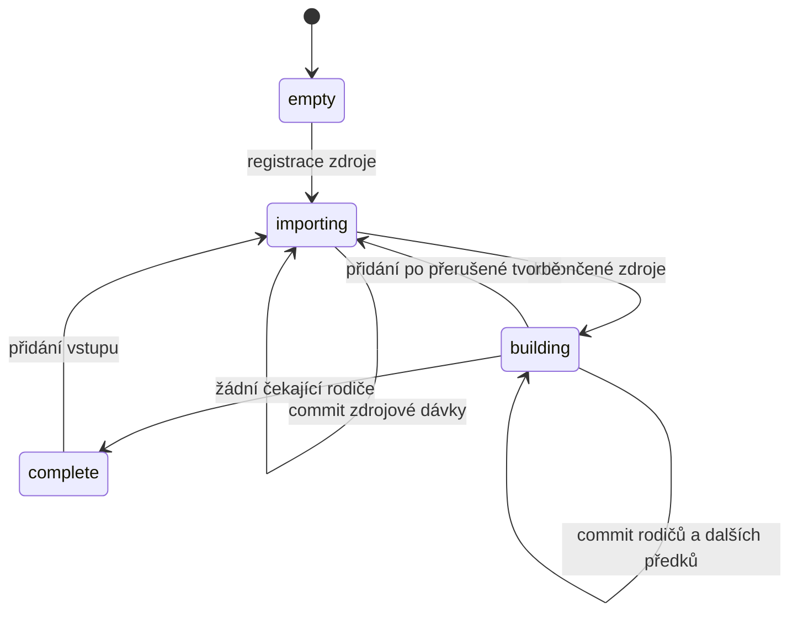

# Architektura a údržba

[English](ARCHITECTURE.md) | **Čeština**

Verze 2 používá spravované schéma **3**. Výchozí `pyramid` importuje společnou základní úroveň a nižší zoomy vytváří ze společného detailu. Explicitní `overlay` importuje všechny dodané úrovně bez generování. Oba režimy sdílejí jediného writera a bezztrátové kódování.

## Mapa kódu

| Funkce | Odpovědnost |
|---|---|
| `merge` | Zámek, kontrola historie, plán importů, obě fáze a dokončení |
| `open_output` | Odmítnutí cizích/starých výstupů, schéma, pevná nastavení, WAL/cache |
| `prepare_sources` | Kontrola skutečných maxim nebo explicitního společného zoomu před importem pixelů |
| `source`, `digest`, `preflight` | Zamčené snapshoty, SHA-256 a neměnná historie |
| `read_batch`, `import_source` | Bajtově omezené čtení, pořadí zdrojů a atomické kurzory |
| `lossless_webp`, `process_tile` | Validace, bezpečná kopie, překódování ztrátového WebP a alfa compositing |
| `mark_parents` | Deduplikované označení bezprostředních rodičů v transakci pixelů |
| `read_overview_batch`, `build_pyramid` | Nejvyšší čekající zoom, omezené čtení potomků, atomická náhrada rodičů a propagace |
| `process_overview` | TMS sestavení, přednásobení alfy, BOX zmenšení a bezztrátové kódování |
| `bounded_results` | Společné spouštění workerů a backpressure |
| `update_metadata` | Rozsahy/atribuce, indexovaná minima/maxima zoomů a fáze |
| `status`, `verify` | Stav evidence, odmítnutí nedokončeného/tainted výstupu a dekódování |

## Pevný kontrakt

`_merge_config` ukládá režim, základní a minimální zoom, velikost dlaždice, formát, kompresi, pevný resampling `box-premultiplied-alpha` a `lossless=true`. Vynechané volby režimu/zoomů/formátu se převezmou. Název/popis/typ se mohou měnit.

Základní úroveň vychází z indexovaných klíčů, ne deklarace maxzoom. Automatika vyžaduje shodná skutečná maxima neprázdných navržených vstupů; explicitní úroveň musí být v každém přítomná. Plán otevírá postupně jeden zdroj a drží jen malé deskriptory. Import úroveň znovu ověří ve vlastním zamčeném snapshotu. První zcela prázdná sada vyžaduje explicitní zoom. Ostatní dodané zoomy se v pyramidě ignorují.

Schémata 1/2 patří verzi 1.x. Odmítej je před změnou journal mode/dat. Již složené nižší zoomy nelze tiše reinterpretovat jako odvozenou pyramidu ani předpokládat jejich bezztrátovost. Nový výstup se staví z původních zdrojů. Starý archiv lze vědomě použít jako zploštěný zdroj; původní vrstvy se neobnoví.

## Writer a pořadí

SQLite spojení vlastní jen rodič. Workery vznikají přes `spawn`; nepředávej spojení ani nepoužívej fork s otevřeným spojením. Základní úloha je `(z,x,y,new_bytes,old_bytes_or_None)`, přehled `(z,x,y,(SW,SE,NW,NE))`, kde potomek může být `None`. Výsledek je `(z,x,y,encoded_bytes)`.

Dokonči jeden zdroj před dalším: source-over závisí na pořadí a opakovaná potvrzená poloprůhledná vrstva mění obraz. Uvnitř zdroje jsou klíče unikátní, takže pořadí dokončení workerů nevadí. Po dokončení všech navržených zdrojů se vytvářejí rodiče; i jejich dávka má unikátní klíče.

Různí rodiče mohou běžet paralelně. Rodič se však nesmí počítat před potvrzením všech čekajících potomků o úroveň výše. Nejvyšší klíč `_merge_dirty` a indexovaný prefix daného zoomu tuto bariéru udržují i při přerušené tvorbě nebo přidání zdrojů.

## Trvalý stav

| Tabulka | Význam |
|---|---|
| `tiles`, `metadata` | Standardní MBTiles obrázky a zobrazovací metadata |
| `_merge_config` | Schéma a pevný kontrakt |
| `_merge_sources` | Priorita, absolutní cesta, hash, stat token, active/complete/tainted, potvrzený kurzor a statistiky |
| `_merge_attributions` | Deduplikované celé texty atribucí |
| `_merge_dirty` | Disková množina čekajících rodičů `(z,x,y)` s primárním klíčem |
| `_merge_state` | Globální fáze a kumulativní počet potvrzených zápisů přehledů |

Fáze:

Overlay přechází z importu přímo do complete. Dokončený zdroj může být součástí nedokončené pyramidy. Změna zdroje během jeho importu vede na tainted a blokuje další práci. Samotná neshoda hashe při preflightu předchozí pixely neoznačí jako tainted.

## Atomické hranice a obnova

Základní dávka:

1. Indexovaně načti klíče/délky, zjisti staré délky přes malou dočasnou tabulku, zvol souvislý prefix podle bajtů a načti jen jeho bloby.
2. Zahaj transakci, odešli omezené úlohy a zapisuj omezenými SQL buffery.
3. Znovu ověř stabilitu zdroje, uprav kurzor/počty/rozsahy, vlož bezprostřední rodiče a metadata.
4. Potvrď společně a proveď checkpoint.

Chyba neposune pixely, kurzor ani rodiče. Potvrzená dávka se neopakuje. Registrace a dokončení jsou malé samostatné transakce, dokončení až po závěrečném hashi.

Přehledová dávka:

1. Vyber nejvyšší čekající zoom a omezený prefix rodičů. Vytvoř nejvýše čtyři klíče potomků na rodiče.
2. Přečti délky přes primární klíč, zvol bajtově omezený prefix a načti jen jeho bloby. Chybějící potomci jsou průhlední.
3. V transakci sestav aktuální potomky a nahraď rodiče. Původní obraz rodiče nikdy nevstupuje do výpočtu.
4. Vlož další předky, odstraň právě hotové čekající klíče, zvyš počet zápisů, uprav metadata a společně potvrď. Následuje checkpoint.

Pád před commitem ponechá rodiče čekající. Pád po commitu zachová pixely i další předky. Nové základní pixely mohou rozšířit přerušenou tvorbu: klíče se deduplikují a pořadí od nejvyššího zoomu opraví potomky před jejich rodiči. Pád po posledním rodiči před finálním dokončením ponechá building s prázdnou frontou; resume bezpečně nastaví complete.

Publikovatelný je pouze complete. Během běhu mohou čtenáři vidět nový detail se starými/chybějícími přehledy. Stav ukazují metadata a status, verify nedokončený výstup odmítne. Cizí prohlížeč vlastní metadata může ignorovat; provozovatel publikuje až zavřený dokončený archiv.

## Obrazové operace

`decode` před alokací Pillow kontroluje PNG/WebP strukturu, signaturu, rozměry a délky. Statické osmibitové zobrazovací rastry se převádějí do RGBA. Animace a 16bitové zdroje se odmítají; barevné profily se netransformují. Mřížka/CRS musí odpovídat předem.

`process_tile` ověří každou importovanou dlaždici. Jedinečné shodné PNG se kopíruje; WebP jen tehdy, pokud validované RIFF chunky obsahují bezztrátové VP8L RGB. Ztrátové VP8 se i bez překryvu bezztrátově překóduje. Zachovají se dekódované pixely, nikoli původně ztracený detail. Překryvy používají `Image.alpha_composite(existing,new)`.

`process_overview` vloží potomky do RGBA plátna `2S × 2S`. TMS dy=1 je sever a má obrazové y=0; dy=0 má y=S. Následuje přednásobené `RGBa`, BOX zmenšení dvakrát, převod do RGBA a kódování. BOX nepotřebuje okolí mimo čtyři potomky. Filtr s větším dosahem by vyžadoval okolní pixely a nové testy švů; nestačí vyměnit konstantu filtru.

PNG má uloženou úroveň komprese, WebP `lossless=True, exact=True`. Původní bezztrátové shodné bajty mohou mít vlastní kompresní úsilí. Bezztrátové kódování neodstraní zaokrouhlování osmibitového výpočtu. `verify --decode` odmítne zvenku vložené ztrátové WebP.

## Účtování paměti

Omezuje se počet i kódované bajty. Základní úloha rezervuje zdroj, starý výstup a maximální výsledek. Jen jedinečné deklarované shodné PNG může před čtením rezervovat svou původní délku; deklarace WebP neznamená kopii. Přehled rezervuje až čtyři potomky a jeden maximální výsledek. Pyramida vyžaduje nejméně `5 × max_tile_mib`, overlay trojnásobek.

Dočasné tabulky a Python deskriptory jsou omezené batch_size, pro potomky čtyřnásobně. `_merge_dirty` je trvalý diskový stav. Primární klíč tiles začíná zoomem, takže min/max i čtení úrovně používají index. Nenahrazuj je GROUP BY nad celým výstupem ani neomezeným čtením blobů.

`bounded_results` omezuje všechny pending/hotové-neodebrané futures na max_inflight. Výsledky předává před doplněním a při chybě čekající úlohy ruší. SQL buffery mají limit počtu/bajtů. Starou dávku uvolni před další. Chyba workeru vrací výstupní transakci; restart určují kurzory a čekající rodiče.

Rozpočty nejsou tvrdé RSS. Přidávají se kopie při serializaci, procesy Python/Pillow, dekódované obrázky, větší přehledové plátno a nativní kodéry. Seznam cest/deskriptory rostou s počtem souborů; obrazové buffery nerostou s celkovým počtem dlaždic. Cache jsou explicitní, mmap vypnutý, dočasná data mohou přetéct na disk. Tvrdý limit poskytuje OS.

## Hashování, metadata a disk

Vstup drží čtecí transakci během počátečního hashe, importu i závěrečného hashe. Po BEGIN ihned čti schéma kvůli sdílenému zámku; nepoužívej immutable=1. WAL vstupy se odmítají, protože hash hlavního souboru neobsahuje WAL. Na hranicích se kontroluje zařízení/inode/velikost/mtime/ctime a živé journaly.

Každé spuštění hashuje celou historii. Zachytí změny se zachovanými stat údaji, ale samostatné spuštění pro každý soubor je drahé. Pro počáteční sadu použij jeden seznam. Obsahová verifikace se tiše nenahrazuje stat-only cache.

Bounds agregují malou evidenci zdrojů, podle deklarací nebo základních dlaždic. Přehledové dlaždice nesmějí rozšířit geografické bounds. Skutečné zoomy se získají indexovaným krajním vyhledáním. Fáze/metadata patří do transakce pixelů. Atribuce má samostatný limit.

WAL používá FULL synchronizaci a explicitní TRUNCATE checkpointy. Blokující čtenář práci zastaví; poslední transakce již může být potvrzená a nesmí se opakovat. Soubor zámku zůstává po skončení; smazání drženého souboru by umožnilo druhý zámek na jiném inode. Vyžaduj lokální SQLite disk a místo pro čekající klíče, WAL, indexy i výstup.

## Ověření a balíčkování

`test_merge.py` zachovává pořadí, bezpečnost a zdrojové crash testy. `test_png.py` pokrývá formáty, validaci a odmítnutí starých evidencí. `test_pyramid.py` ověřuje obrazové příklady, TMS, sloučení před zmenšením, selektivní přepočet, bezztrátový převod, společný zoom a skutečný SIGKILL v obou fázích/formátech. `benchmark_pyramid.py` ověřuje tisíce archivů, počet deduplikovaných předků a RSS. `benchmark_memory.py` zpracovává větší zdrojové objemy.

Veřejný modul/příkaz volají `merge_mbtiles.main`; VERSION zůstává jedním literálem. `check_release.py` ověřuje obsah/identitu archivů a shodu tagu, `smoke_installed.py` nainstalované i ze sdistu přestavěné wheely mimo checkout, reálné workery, oba kodéry a celou pyramidu. MANIFEST obsahuje jen čtyři jmenované syntetické MBTiles, nikdy obecný glob dat.

Po změně pořadí, schématu, kódování nebo dávkování spusť celou sadu. Po změně bufferů změř paměť. Udržuj EN/CS dokumentaci a po finálních úpravách přegeneruj SHA256SUMS sledovaných souborů. Publikování řeší [RELEASING.cs.md](RELEASING.cs.md). Komentáře/docstringy jsou anglické, zdroje mají MIT SPDX hlavičky.
