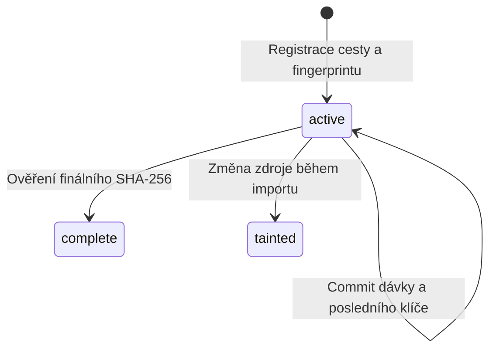

# Architektura a údržba

[English](ARCHITECTURE.md) | **Čeština**

Tento dokument vysvětluje pravidla v [merge_mbtiles.py](merge_mbtiles.py). Podporované vstupy a příkazy popisuje [README](README.cs.md). Komentáře a docstringy ve zdrojovém kódu jsou anglicky.

## Mapa kódu

| Oblast | Vstupní funkce | Odpovědnost |
|---|---|---|
| CLI | `parser`, `main` | Ověření limitů, signály, výběr příkazu a návratové kódy. |
| Řízení běhu | `merge`, `collect_inputs`, `output_lock` | Pořadí zdrojů, vyloučení druhého writeru, kontrola historie a dokončení aktivního zdroje. |
| Zdrojové snapshoty | `source`, `token`, `assert_static`, `digest`, `preflight` | Čtecí zámky, detekce změn a ověření všech historických příspěvků. |
| Příprava databáze | `open_output`, `connection_limits` | Schéma, nastavení výstupu a omezení bufferů spojení. |
| Příprava dávky | `read_batch`, `validate_schema` | Indexované stránkování a výběr podle délek před načtením blobů. |
| Obrazové workery | `bounded_results`, `process_tile`, `decode`, `encode` | Backpressure, validace, kopírování, převod a skládání dlaždic. |
| Trvalý stav | `import_source`, `update_metadata`, `_commit`, `checkpoint` | Společný commit pixelů a postupu, potom checkpoint WAL. |
| Kontroly | `status`, `verify` | Malá evidence nebo výslovný průchod SQLite a obrázků výstupu. |

Úloha má tvar `(z, x, y, new_bytes, old_bytes_or_None)`, výsledek `(z, x, y, output_bytes)`. Souřadnice jsou všude TMS. Pořadí hodnot v Python n-ticích odpovídá sloupcům SQL; při změně je potřeba ověřit všechny producenty i konzumenty.

## Jediný writer a pořadí zdrojů

Hlavní proces vlastní zdrojové i jediné výstupní SQLite spojení. Workery vznikají přes `spawn` a dostávají pouze bajty a parametry. Nepředávej jim SQLite spojení a nepřepínej na `fork` s otevřenými spojeními.

Paralelně běží jen dlaždice aktuálního zdroje. Jejich klíče jsou unikátní, takže pořadí dokončení workerů výsledek nemění. Pořadí zdrojů ho mění: `Image.alpha_composite(existing_output, new_source)` kreslí nový zdroj přes dosavadní obraz. Aktivní zdroj se musí dokončit před novým, i když ho další příkaz neuvede.

Výstupní zámek je kooperativní a drží se po celý běh. Jeho soubor zůstává po uvolnění na disku; smazání drženého zámku by umožnilo druhému procesu zamknout jiný inode. Přímé změny výstupu jinými nástroji nejsou podporované.

## Stav importu a obnova po pádu

`active` bez posledního klíče znamená, že se nepotvrdila žádná dávka dlaždic. `complete` znamená úspěšnou finální kontrolu hashe. `tainted` blokuje další import a vyžaduje nový výstup; smazání příznaku neopraví pixely načtené z nestabilního zdroje.

Neshoda SHA při preflightu je odlišná: import ještě nezačal, takže výstup neoznačí jako tainted. Obnovení přesných původních bajtů umožní pokračovat.

Dávka má následující průběh:

1. Načíst klíče a délky pomocí `(z,x,y) > last_committed_key`, bez `OFFSET`.
2. Najít překryvy malou dočasnou tabulkou a indexovaným vyhledáváním ve výstupu.
3. Vybrat souvislý prefix podle počtu a bajtového rozpočtu; načíst jen jeho bloby.
4. Zahájit `BEGIN IMMEDIATE`, spustit omezené úlohy a zapisovat výsledky SQL dávkami.
5. Znovu ověřit stabilitu zdroje. Aktualizovat poslední klíč, počty, zoomy, rozsahy a metadata.
6. Potvrdit **všechny** tyto změny společně. Potom mimo transakci zavolat `wal_checkpoint(TRUNCATE)`.

Pád před commitem vrátí celou dávku; po commitu se dávka přeskočí. Opakované nanesení potvrzené poloprůhledné vrstvy by změnilo pixely. Retry proto nesmí takovou dávku znovu skládat. Pokud checkpoint blokuje čtečka, předchozí dávka již zůstala potvrzená. Import zastaví a naváže po zavření čtečky.

Registrace a dokončení zdroje jsou samostatné malé transakce. Trvale uložený poslední klíč označuje potvrzené dlaždice, nikoli odeslané nebo právě dokončené úlohy. Chyba SQL/workeru vrátí aktuální dávku a ponechá starší commity.

## Účtování paměti

`read_batch` počítá zdrojové bajty, staré bajty výstupu a rezervu výsledku. Překryv nebo možný převod formátu rezervuje `max_tile_mib`. Jedinečná dlaždice deklarovaná ve formátu výstupu může rezervovat původní velikost: worker deklaraci ověří před kopírováním. Při změně rychlé kopírovací větve toto ověření zachovej.

`batch_size` omezuje režii klíčů a řádků, `batch_mib` kódovaná data. Čtení délek před bloby brání načtení příliš velké dlaždice ještě před odmítnutím. Pevné pořadí joinu brání plnému průchodu výstupu pro každou dávku.

`bounded_results` odešle nejvýše `max_inflight` futures včetně hotových neodebraných výsledků. Výsledky předá před doplněním poolu, takže pomalý SQL writer zpomalí producenty. Nenahrazuj ho načtením všech úloh přes `map`, neomezenou frontou ani seznamem všech výsledků. SQL buffery mají také početní a bajtový limit; před další dávkou se stará uvolní.

Rozpočty nejsou tvrdým limitem RSS. Přidávají se kopie při serializaci, procesy Python/Pillow, dekódované RGBA buffery, metadata PNG a paměť nativních kodeků. Rozměry a bloby jsou omezené, SQLite cache mají limit, mmap je vypnutý a dočasné tabulky mohou přetéct na disk. Absolutní celkový limit nastavuje provozní prostředí.

## Integrita zdrojů a formáty

Čtecí transakce zdroje zahrnuje první hash, import i poslední hash. Po `BEGIN` se čte schéma, aby se skutečně získal sdílený zámek. WAL zdroje se odmítají, protože samotný hlavní soubor nemusí obsahovat celý jejich viditelný stav. `immutable=1` není bezpečná optimalizace: obchází potřebné zamykání.

Stat tokeny zachytí výměnu zařízení/inodu a změnu velikosti, mtime či ctime. ctime se může změnit i při změně metadat, což záměrně vede ke konzervativnímu zastavení. SHA-256 ověřuje obsah i při obnovení velikosti/mtime. Vstupy musí být offline a neměnné; přímé zápisy obcházející SQLite zámky nejsou podporované.

Signatury a hlavičky se ověřují před alokací pixelů v Pillow. WebP kontroluje VP8X i rozměry VP8/VP8L, PNG hlavičku IHDR, hranice/CRC chunků a statický obraz. Pillow potom dekóduje podporovaný 8bitový zobrazovací rastr do RGBA. 16bitové PNG a animace se výslovně odmítají. Merger nemění velikost dlaždic, nespravuje barevné profily, nereprojektuje ani neořezává polygonem.

Jedinečná dlaždice se kopíruje bajtově jen při shodě s formátem výstupu. Ostatní se převádějí; překryvy se skládají a bezztrátově kódují. Již ztracené pixely původního ztrátového vstupu nelze obnovit. Nastavení komprese platí pro nově kódované dlaždice, nikoli původní kopírované bajty.

## Evidence, metadata a kompatibilita

| Tabulka | Význam |
|---|---|
| `tiles` | Standardní souřadnice MBTiles a jeden zvolený formát obrázků. |
| `metadata` | Zobrazovací metadata aktualizovaná s potvrzenými pixely. |
| `_merge_sources` | Pořadí, cesta/hash/stat token, stav, poslední klíč a průběžné statistiky zdroje. |
| `_merge_config` | Verze schématu a nastavení výstupu/kodéru. |
| `_merge_attributions` | Unikátní atribuce s omezenou souhrnnou velikostí. |

`tile_count` počítá příspěvky zdrojů, nikoli unikátní výstupní dlaždice. Zoomy vycházejí z potvrzených klíčů. Bounds používají validní deklaraci nebo celé importované dlaždice, bez ořezu podle alfa kanálu. Celková metadata agregují malou evidenci a neprocházejí stále celou tabulku dlaždic. Deklarovaný rozsah rozpracovaného zdroje může zahrnovat dosud nenačtené části.

`VERSION` programu a `SCHEMA_VERSION` mají odlišný účel. Verze 1.1 interpretuje schéma 1 jako WebP a trvale ho povýší na 2 při nejbližším úspěšném commitu dávky nebo finálních metadat. Verze 1.0 schéma 2 odmítne, aby nepoškodila PNG výstup původním WebP kódem. Formát, velikost dlaždic a aktivní kompresní parametr jsou při resume pevné.

U nekompatibilní změny nejdřív stanov migraci a chování starších klientů. Tato nastavení se během života archivu nesmějí tiše přepnout.

## Testy a bezpečné rozšiřování

- [tests/test_merge.py](tests/test_merge.py) ověřuje pořadí, metadata, zámky, detekci změn, rollback a skutečný SIGKILL kolem commitu pro oba formáty.
- [tests/test_png.py](tests/test_png.py) ověřuje smíšené formáty, pixely, strukturu/režimy PNG, velikost výsledků, jednotný formát a migraci evidence.
- [examples/create_demo.py](examples/create_demo.py) vytváří nezávislé 512px vstupy a očekávaný obraz přímo přes Pillow.
- [tests/benchmark_memory.py](tests/benchmark_memory.py) měří strom procesů CLI, bez přípravy dat a měřicího procesu. Vzorkuje RSS, takže může započítat sdílené stránky vícekrát a minout krátké špičky.

Před změnou dávkování, pořadí, kódování nebo schématu spusť `python -m unittest discover -s tests -v`. Zachovej pixelové porovnání, kontrolu přeskočení potvrzené dávky, rezervu výsledku převodu a crash testy. Změna toku dat či spotřeby prostředků vyžaduje nové měření na reprezentativních datech; samotné komentáře nové výkonnostní měření nepotřebují. Při přípravě release archivu po poslední změně všech souborů přegeneruj `SHA256SUMS`.

Kód i související projektová dokumentace jsou zveřejněny pod [licencí MIT](LICENSE.md).

## Balíčkování a vydávání

[mbmerge.py](mbmerge.py) zpřístupňuje `python -m mbmerge` a `__version__`. Nainstalovaný příkaz používá stejný `main()` v `merge_mbtiles.py`; původní skript zůstává kompatibilní. [pyproject.toml](pyproject.toml) balí výslovně tyto dva moduly, dynamicky načítá VERSION a přebírá závislost Pillow z requirements.txt.

[MANIFEST.in](MANIFEST.in) přidává zdrojové testy/dokumentaci a jen čtyři jmenované syntetické databáze, nikdy obecný glob všech MBTiles. [tools/check_release.py](tools/check_release.py) ověřuje identitu zdrojů, wheelu, sdistu a produkční tag. [tools/smoke_installed.py](tools/smoke_installed.py) záměrně používá nainstalovaný wheel, izolovaný Python a dočasný pracovní adresář CLI.

[RELEASING.cs.md](RELEASING.cs.md) popisuje znovupoužitelné CI a oddělené publikační joby s OIDC. Při změně balíčkování či vstupních bodů znovu sestav a vyzkoušej wheel i wheel ze sdistu; samotné zdrojové testy chybějící soubory distribuce neodhalí.
