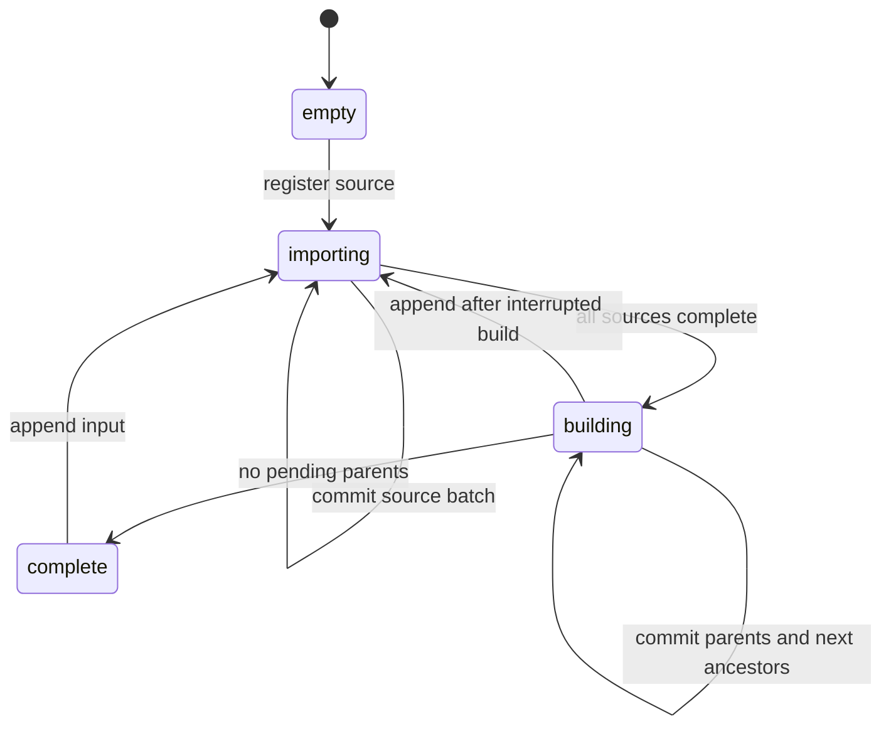

# Architecture and maintenance

**English** | [Čeština](ARCHITECTURE.cs.md)

Version 2 uses managed schema **3**. The default `pyramid` pipeline imports one common source level and derives lower levels from the merged detail. Explicit `overlay` mode imports all supplied levels without generating any. Both modes share one writer and lossless output encoding.

## Code map

| Function | Responsibility |
|---|---|
| `merge` | Lock output, verify historical sources, plan imports, run both phases, mark complete |
| `managed_objects`, `open_output` | Read-only refusal of unmanaged/old outputs, create schema, freeze settings, establish WAL/caches |
| `prepare_sources` | Check actual source maxima or an explicit common base before importing proposed pixels |
| `source`, `digest`, `preflight` | Locked read snapshots, SHA-256 identity, immutable historical input contract |
| `read_batch`, `import_source` | Byte-bounded base/all-level reads, ordered source composition, atomic source checkpoints |
| `lossless_webp`, `process_tile` | Validate images, copy only safe matching tiles, transcode lossy WebP, alpha composite |
| `mark_parents` | Insert deduplicated immediate ancestors in the pixel transaction |
| `read_overview_batch`, `build_pyramid` | Highest-dirty-level reads, bounded child lookup, atomic parent replacement and propagation |
| `process_overview` | Assemble TMS children, premultiply alpha, BOX downsample, lossless encode |
| `bounded_results` | Shared spawned-worker dispatcher and backpressure for either image operation |
| `update_metadata` | Source extents/attributions, indexed output zoom extrema, mode/phase metadata |
| `status`, `verify` | Ledger/state report; reject incomplete/tainted outputs and optionally decode images |

## Immutable contract

`_merge_config` stores mode, base zoom, minimum zoom, tile dimensions, output format, compression settings, fixed `box-premultiplied-alpha` resampling and `lossless=true`. Omitted mode/base/minimum/format options infer existing values. Name/description/type may change.

The base level is selected from actual indexed tile keys, never declared maxzoom. Automatic selection requires equal maxima across nonempty proposed inputs. Explicit selection requires that level in every nonempty input. Planning reads one source at a time and retains only small descriptors. The level is rechecked under the import snapshot. Empty-only initial input lists need an explicit level. Imported sources may contain lower/higher levels; only the selected base is used in pyramid mode.

Schemas 1 and 2 belong to version 1.x. A read-only ownership/schema probe runs before any writable open, so rejection cannot checkpoint an existing WAL as a side effect. Do not silently reinterpret already composed lower levels or assume their WebP was entirely lossless. Rebuild from original sources to a new output. The old archive may be used as an explicitly flattened source but cannot recover original layers.

## Writer and ordering

Only the parent process owns SQLite connections. Workers use `spawn`; never pass a connection to a worker or fork an open connection. A base job is `(z,x,y,new_bytes,old_bytes_or_None)`. An overview job is `(z,x,y,(SW,SE,NW,NE))`, with bytes or `None` per child. Workers return `(z,x,y,encoded_bytes)`.

Finish one source before starting the next: source-over alpha composition is order-dependent and repeating a committed translucent contribution changes it. Within one source, unique keys make worker completion order irrelevant. After all proposed sources complete, generate parents. Parent keys in one batch are unique too.

Different parent jobs can run concurrently. A parent cannot be calculated until all pending children at its next higher level are committed. `SELECT z FROM _merge_dirty ORDER BY z DESC LIMIT 1` and an indexed prefix read enforce this barrier even when a previous build was interrupted or new base data was added.

## Persisted state

| Table | Meaning |
|---|---|
| `tiles`, `metadata` | Standard MBTiles images and display metadata |
| `_merge_config` | Schema and immutable processing contract |
| `_merge_sources` | Source priority, absolute path, SHA-256, stat token, active/complete/tainted status, committed cursor, counts/extents |
| `_merge_attributions` | Deduplicated complete source attribution strings |
| `_merge_dirty` | Disk-backed primary key set of pending `(z,x,y)` parents |
| `_merge_state` | Global phase and cumulative committed overview write count |

Global phases:

Overlay mode goes from importing directly to complete. A complete source can coexist with an incomplete global pyramid. A source detected changing during its import becomes tainted; further imports/builds are refused. A preflight hash mismatch alone does not taint already committed pixels.

## Atomic boundaries and recovery

For a base import batch:

1. Read indexed keys/lengths, lookup existing lengths with a bounded temporary table, choose a contiguous byte-budget prefix, then fetch only its blobs.
2. Begin the output transaction and dispatch bounded jobs. Stream results through bounded SQL buffers.
3. Recheck source stability. Update the committed source cursor/counts/extents, insert immediate dirty parents and update metadata.
4. Commit all changes together, then checkpoint WAL.

A failed batch advances neither pixels nor cursor/dirty work. A committed batch resumes after its cursor; never replay it. Source registration and completion are separate small transactions, and completion follows a final whole-file hash.

For an overview batch:

1. Select the highest pending level and an indexed bounded prefix of parents. Construct up to four child keys per parent.
2. Fetch lengths via primary-key probes, select a byte-budget prefix, then fetch only those child blobs. Missing children remain transparent.
3. Begin a transaction, calculate current child mosaics and replace parent images. Never read the previous parent as an image input.
4. Insert the next ancestors, delete exactly the completed dirty keys, increment the overview count, update metadata and commit atomically. Then checkpoint.

Before-commit failure leaves parents dirty. After-commit failure leaves both pixels and the next ancestors durable. Adding base data while an old build is pending is safe: dirty keys deduplicate, and highest-level-first regeneration refreshes all affected ancestors before their parents. A crash after the last parent but before final completion leaves `building` with an empty dirty set; resume can safely mark complete.

Only `complete` is a publishable state. During work, readers can observe new detail and stale/missing overviews. `metadata['mbmerge:phase']` and `status` expose this; `verify` refuses incomplete output. External tools may ignore custom metadata, so the operator must publish only closed completed archives.

## Image rules

`decode` validates PNG/WebP signatures, structure, dimension and length limits before Pillow allocates image buffers. Static 8-bit display rasters become RGBA. Animated and 16-bit sources are rejected; color profiles are not transformed. The grid/CRS must already match.

`process_tile` validates every imported tile. Unique matching PNG is copied, and unique matching WebP is copied only if validated RIFF chunks contain VP8L lossless RGB. VP8 lossy WebP is re-encoded losslessly even if unique. This preserves its decoded pixels, not detail already lost in the source. Overlaps use `Image.alpha_composite(existing,new)`.

`process_overview` pastes four RGBA children into a `2S × 2S` canvas. TMS dy=1 is north and goes at image y=0; TMS dy=0 goes at image y=S. Convert to Pillow's premultiplied `RGBa`, BOX resize by two, convert back to RGBA, then encode. BOX has no halo outside these four tiles. A larger-support filter would require neighboring pixels and new seam tests; do not merely replace the filter constant.

PNG uses the recorded compression level. WebP uses `lossless=True, exact=True`. Original lossless matching bytes may retain their own compression effort. Lossless encoding does not remove 8-bit compositing/resampling rounding. `verify --decode` rejects lossy WebP externally inserted into a managed archive.

## Resource accounting

Both row count and encoded bytes are bounded. Base jobs reserve source, old output and worst-case result bytes. Only unique declared matching PNG can reserve its original result length before fetching; a WebP declaration does not imply a byte copy. Overview jobs reserve up to four child blobs and one maximum-sized result. Pyramid batches require at least `5 × max_tile_mib`, overlay batches `3 × max_tile_mib`.

Temporary key tables and Python descriptors are bounded by batch_size (fourfold for child keys). `_merge_dirty` is durable SQLite storage, not an in-memory global set. The tile primary key starts with zoom, so output min/max lookup and per-level child searches use indexes. Do not replace them with GROUP BY over the full output or unbounded blob fetches.

`bounded_results` limits all pending/completed-unconsumed futures to max_inflight, yields results before refilling and cancels pending futures on failure. Parent SQL buffers are limited by count and bytes. Release references to a batch before reading the next one. A process-pool worker failure rolls back its output transaction; sources and dirty keys provide the restart position.

The budgets do not cap RSS. Add serialization copies, Python/Pillow processes, decoded images, the larger overview canvas and native codec working memory. Source path lists/descriptors are proportional to file count; tile buffers are not proportional to total tiles. Caches are explicit, mmap is disabled and temporary SQLite data may spill. OS-level resource limits are the hard cap.

## Hashing, metadata and storage

Inputs use one read transaction during pre-import hash, import and final hash. Read the schema immediately after BEGIN to acquire its shared lock; do not use immutable=1. WAL sources are refused because a hash of the main file would miss WAL contents. Device/inode/size/mtime/ctime and live journals are checked at batch boundaries too.

Every invocation hashes every historical source. Strict hashing protects against preserved-stat edits but makes one invocation per file expensive. Use one input list for large initial imports. No stat-only cache is silently substituted for content verification.

Bounds aggregate the source ledger (at most thousands of small rows), using valid declarations or imported base tile extents. Overview tile footprints must not inflate geographic bounds. Actual committed output zoom extrema are indexed end-point reads. The phase and metadata change in the pixel transaction. Attribution values and total size are bounded independently.

Output WAL uses FULL synchronization and explicit TRUNCATE checkpoints after commits. If a reader blocks a checkpoint, stop; the last transaction may already be committed and must not be replayed. The cooperative lock file stays after exit; deleting a held lock would permit a second writer on a different inode. Require local SQLite-compatible storage and keep free space for dirty keys, WAL, indexes and output.

## Verification and packaging

`tests/test_merge.py` retains ordered-overlay, safety and source crash coverage. `tests/test_png.py` covers encodings, validation and refusing old ledgers. `tests/test_pyramid.py` checks independent pixel cases, TMS, merge-before-resize, selective rebuilds, lossless transcoding, common-level validation and real SIGKILL boundaries in both phases/formats. `benchmark_pyramid.py` checks thousands of separate archives, deduplicated ancestor counts and process-tree RSS; `benchmark_memory.py` exercises larger source payloads.

The public module/console script delegate to `merge_mbtiles.main`; VERSION remains one literal source. `tools/check_release.py` checks archive contents/identity and exact release tag. `tools/smoke_installed.py` exercises installed wheels and sdist-rebuilt wheels outside the checkout, including real workers, both encoders and a complete pyramid. MANIFEST includes only four named synthetic MBTiles; never add a generic data glob.

Run the complete suite after changes to ordering, schema, encoders or batching. Record fresh memory measurements when processing buffers change. Keep English/Czech docs aligned and regenerate tracked-file SHA256SUMS after final edits. [RELEASING.md](RELEASING.md) covers publishing; source comments/docstrings are English and files use MIT SPDX headers.
