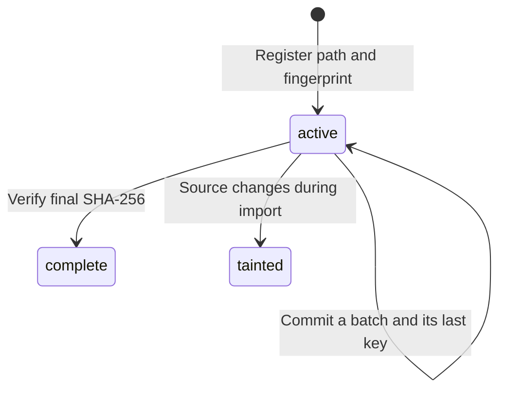

# Architecture and maintenance

**English** | [Čeština](ARCHITECTURE.cs.md)

This guide explains the invariants behind [merge_mbtiles.py](merge_mbtiles.py). Read the [README](README.md) for supported inputs and commands. Source comments and docstrings are in English.

## Code map

| Area | Entry points | Responsibility |
|---|---|---|
| CLI | `parser`, `main` | Validate limits, handle signals, dispatch commands and report exit codes. |
| Run orchestration | `merge`, `collect_inputs`, `output_lock` | Resolve source order, exclude other writers, validate history and finish active sources first. |
| Source snapshots | `source`, `token`, `assert_static`, `digest`, `preflight` | Keep read locks, detect changes and verify every historical contribution. |
| Database setup | `open_output`, `connection_limits` | Create the managed schema, resolve encoding settings and constrain connection buffers. |
| Batch preparation | `read_batch`, `validate_schema` | Use indexed keyset reads and length-based selection before fetching bounded blobs. |
| Image workers | `bounded_results`, `process_tile`, `decode`, `encode` | Apply backpressure, validate images, copy/transcode or composite tiles. |
| Durable state | `import_source`, `update_metadata`, `_commit`, `checkpoint` | Commit pixels and progress together, then checkpoint WAL. |
| Inspection | `status`, `verify` | Inspect the small ledger or explicitly scan SQLite/output images. |

The job tuple is `(z, x, y, new_bytes, old_bytes_or_None)`; the result is `(z, x, y, output_bytes)`. Coordinates are TMS throughout. The Python tuple order mirrors SQL column order; changing one requires checking all producers and consumers.

## One writer and ordered sources

The parent process owns both the source connection and the single output connection. Workers are created with `spawn` and receive bytes/parameters only. Never pass SQLite handles to the pool or switch to `fork` with live connections.

Only tiles from the current source run in parallel. Its keys are unique, so worker completion order does not affect the result. Source order does: `Image.alpha_composite(existing_output, new_source)` puts the new source over the old one. An active source must finish before any new source, including when omitted from the next CLI invocation.

The output lock is cooperative and covers the whole run. Its file remains after release; unlinking a held lock could allow a second process to lock a different inode. Direct output edits by other tools are outside the contract.

## Import state and crash recovery

`active` with no last key means no tile batch has committed. `complete` means the source passed its final hash check. `tainted` blocks future imports and requires rebuilding to a new output; clearing the flag does not repair pixels already read from an unstable source.

A preflight SHA mismatch is different: importing has not started, so it does not taint the output. Restoring the exact original source bytes permits resume.

Each batch follows this order:

1. Read keys and encoded lengths using `(z,x,y) > last_committed_key`, with no `OFFSET`.
2. Find output overlaps using the small temporary key table and indexed output lookups.
3. Choose a contiguous prefix fitting count and byte limits; fetch only that prefix's blobs.
4. Start `BEGIN IMMEDIATE`, run bounded worker jobs and write their results in SQL batches.
5. Recheck source stability. Update its last key, counts, zooms, extents and output metadata.
6. Commit **all** those changes together. Then call `wal_checkpoint(TRUNCATE)` outside the transaction.

Before commit, a crash rolls back the whole batch. After commit, resume skips it. Replaying a committed translucent layer would change the pixels; do not implement a retry that composites it again. If checkpointing fails because a reader pins WAL pages, the preceding batch is still committed. Stop and resume after closing the reader.

Source registration and completion are small separate transactions. The persisted last key always refers to committed source tiles, never submitted or merely completed worker jobs. SQL/worker failure rolls back the current batch and leaves earlier commits intact.

## Memory accounting

`read_batch` computes a budget for encoded source bytes, existing output bytes and reserved result bytes. Overlaps and possible format conversions reserve `max_tile_mib` for the result. A unique tile declared in the selected output format can reserve its original size because the worker checks the declaration before copying bytes. Keep that validation if changing the fast path.

Both `batch_size` and `batch_mib` matter. The former bounds key/row overhead; the latter bounds encoded data. Querying lengths first prevents a single oversized source blob from being loaded before rejection. Fixed join order avoids a full output scan for each batch.

`bounded_results` submits at most `max_inflight` futures, including finished results not yet consumed. It yields results before refilling the pool, so slow SQL writes apply backpressure. Do not replace it with an eager `map`, an unbounded queue, or a list of all results. SQL result buffers also have count/byte limits; previous batches are released before reading the next one.

These budgets are not a hard RSS cap. Serialization copies, Python/Pillow processes, decoded RGBA buffers, PNG metadata handling and native codec workspace add overhead. Image dimensions and blob sizes remain bounded, SQLite caches are limited, mmap is disabled, and temporary tables can spill to disk. A hard total limit belongs to the runtime environment.

## Source integrity and format validation

A source read transaction spans initial hash, importing and final hash. `BEGIN` is followed by a schema read to actually acquire the shared lock. WAL sources are rejected because their visible state may not be represented by the main-file hash. Do not add `immutable=1` as an optimization: it bypasses the locking relied on here.

Stat tokens detect device/inode replacement and size/mtime/ctime changes at boundaries. ctime may also change for metadata-only edits, intentionally causing a conservative stop. SHA-256 checks content, including changes hidden by restoring size/mtime. Inputs must remain offline and immutable; raw writes that bypass SQLite locks are unsupported.

Signature/header checks happen before Pillow allocates pixels. WebP checks both VP8X canvas and VP8/VP8L bitstream dimensions; PNG checks IHDR, chunk boundaries/CRCs and static-image constraints. Pillow then decodes the supported 8-bit display image into RGBA. Sixteen-bit PNG and animations are explicitly rejected. The merger does not resize tiles, manage color profiles, reproject data or perform polygon clipping.

A unique tile is copied byte-for-byte only when its format matches the selected output. Other unique tiles are transcoded; overlaps are composited and encoded losslessly. Original lossy input pixels cannot be recovered. Compression settings affect newly encoded tiles, not copied originals.

## Ledger, metadata and compatibility

| Table | Meaning |
|---|---|
| `tiles` | Standard MBTiles coordinates and one selected encoded format. |
| `metadata` | Standard display metadata, updated with committed pixels. |
| `_merge_sources` | Source priority, path/hash/stat token, state, last key and incremental statistics. |
| `_merge_config` | Schema version and output/encoder settings. |
| `_merge_attributions` | Unique attribution strings with a bounded aggregate size. |

`tile_count` counts source contributions, not distinct output tiles. Zooms come from committed keys. Bounds use valid declared source bounds or full imported tile extents, without alpha-edge cropping. Global metadata aggregates the small ledger instead of repeatedly scanning the tiles table. During a partial import, declared source bounds may include its not-yet-imported area.

Program `VERSION` and `SCHEMA_VERSION` serve different purposes. Version 1.1 reads legacy schema 1 as WebP and durably upgrades it to schema 2 in the next successful batch/final metadata transaction. Version 1.0 refuses schema 2, protecting PNG outputs from old WebP-only code. Output format, tile size and the active encoder setting are fixed on resume.

For an incompatible change, define migration/old-client behavior before writing new data. Never silently change these settings halfway through an archive.

## Tests and safe extension

- [tests/test_merge.py](tests/test_merge.py) covers ordering, metadata, locks, change detection, worker rollback and actual SIGKILL at commit boundaries for both formats.
- [tests/test_png.py](tests/test_png.py) covers mixed formats, pixel fidelity, PNG structure/modes, encoding limits, format consistency and legacy-ledger migration.
- [examples/create_demo.py](examples/create_demo.py) builds independent 512px fixtures and an expected image using Pillow directly.
- [tests/benchmark_memory.py](tests/benchmark_memory.py) measures the CLI process tree, excluding fixture creation and the harness. It samples RSS, which can count shared pages twice and omit brief peaks.

Before changing batching, source order, encoding or schema, run `python -m unittest discover -s tests -v`. Keep exact pixel comparisons, committed-batch replay checks, format-conversion byte reservations and crash tests. If dataflow/resource use changes, rerun the benchmark with representative inputs; comments-only changes do not require new performance measurements. Regenerate `SHA256SUMS` when preparing a release archive after all final file changes.

The code and accompanying project documentation are under the [MIT license](LICENSE.md).

## Packaging and release entry points

[mbmerge.py](mbmerge.py) provides `python -m mbmerge` and `__version__`; the installed command points to the same `main()` in `merge_mbtiles.py`. The original script stays compatible. [pyproject.toml](pyproject.toml) explicitly packages these two modules, reads VERSION dynamically and reads Pillow requirements from requirements.txt.

[MANIFEST.in](MANIFEST.in) includes source tests/docs and only four named synthetic databases; it never glob-includes arbitrary MBTiles. [tools/check_release.py](tools/check_release.py) checks source/wheel/sdist identity and production tags. [tools/smoke_installed.py](tools/smoke_installed.py) deliberately imports from an installed wheel, with isolated Python and a temporary CLI working directory.

See [RELEASING.md](RELEASING.md) for the reusable CI workflow and the separate OIDC-only publishing jobs. Changing packaging or entry points requires rebuilding and exercising both the wheel and a wheel rebuilt from sdist; source tests alone cannot detect missing distribution files.
