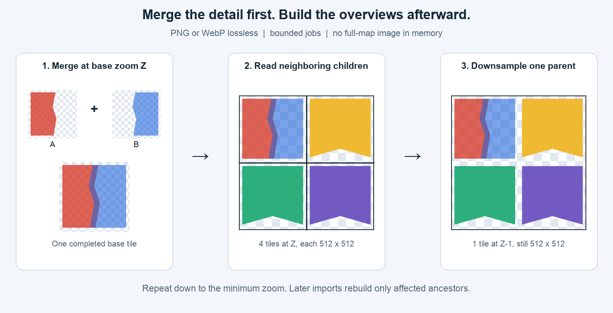
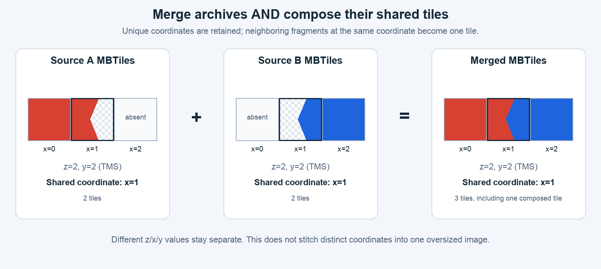
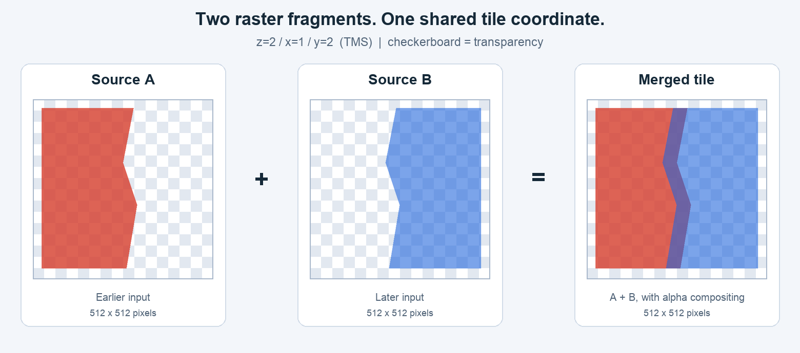

# mbmerge

[English](README.md) | **Čeština**

Inkrementální bezztrátová rastrová mozaika MBTiles: **nejprve sloučit nejvyšší zdrojový zoom, potom vytvořit nižší zoomy ze společného výsledku**. Vstupy PNG/WebP, alfa compositing, omezená paměť, paralelní zpracování obrázků, jediný SQLite writer a obnova po pádu.

**Verze 2 mění výchozí chování.** Nové výstupy používají režim pyramidy. Výstupy verze 1.x se bez změny odmítnou; vytvoř nový výstup z původních zdrojů. Pro zachování a skládání všech dodaných zoomů bez tvorby přehledů zadej výslovně `--mode overlay`.

Podporované prostředí: Linux/macOS (POSIX), Python 3.11+, SQLite 3.35+, Pillow 10.4+. Vstupy musí mít stejnou mřížku Web Mercator/TMS a shodnou čtvercovou velikost dlaždic (výchozí 512 px), plochou indexovanou tabulku `tiles`. Statické PNG a WebP lze kombinovat. Takové vstupy z GDAL rastrů (GeoTIFF, PDF, VRT, JPEG …) vyrobí `mbmerge tile`, který navíc potřebuje příkazy GDAL ≥ 3.11. Windows, JPEG dlaždice, vektorové dlaždice, animace, 16bitové PNG a normalizované MBTiles nejsou podporované.

## Společná mozaika a její pyramida



1. Určí se společný základní zoom `Z` ze skutečných klíčů dlaždic, nikoli z `metadata.maxzoom`.
2. Ze všech zdrojů se v daném pořadí importuje **pouze `Z`**. Pozdější zdroj se kreslí přes předchozí na stejném `z/x/y`.
3. Po dokončení všech navržených importů vznikne `Z-1`, potom `Z-2` až po `--min-zoom` (výchozí 0). Rodič se počítá nejvýše ze čtyř aktuálních potomků pomocí plošného průměru BOX respektujícího alfa kanál. Chybějící potomci jsou průhlední.
4. Při dalším importu se přepočítají jen dotčení předci. Starý přehled se nikdy nepřekrývá novým přehledem.

Automatický výběr vyžaduje **stejný skutečný nejvyšší zoom** všech neprázdných vstupů. Chybějící zvolený zoom se odmítne před importem pixelů z navrženého seznamu. Vedle neprázdných vstupů mohou být i prázdné. Pokud mají zdroje různá rozlišení, zadej explicitní `--base-zoom Z`, který existuje ve všech neprázdných vstupech; vědomě se tím ignorují všechny ostatní úrovně. Žádný zdroj se tiše nevynechá ani nezvětšuje. První zcela prázdná pyramida vyžaduje explicitní základní zoom.

Předpočítané zdrojové přehledy se v pyramidovém režimu ignorují. Nepřenese se tedy případná zvláštní kresba nebo popisky jednotlivých nižších zoomů. Pro takové mapy použij režim overlay.

Na základním zoomu se společné souřadnice skládají; rozdílné souřadnice zůstávají oddělenými dlaždicemi:



Přibalené demo používá skutečné 512px fragmenty. Šachovnice znamená průhlednost:



## Instalace a vyzkoušení

Vydanou verzi lze instalovat přes `pipx install mbmerge` nebo do virtuálního prostředí. Pro test této pracovní verze 2 použij checkout:

```bash
python3 -m venv .venv
source .venv/bin/activate
python -m pip install .
python -m unittest discover -s tests -v

mbmerge merge \
  --input demo/source_a.mbtiles --input demo/source_b.mbtiles \
  --output demo/merged-v2.mbtiles --output-format webp --workers 2
mbmerge status --output demo/merged-v2.mbtiles
mbmerge verify --output demo/merged-v2.mbtiles --decode
```

Demo má základní zoom 2; výstup doplní zoomy 1 a 0. Složená dlaždice zoomu 2 odpovídá `demo/expected_overlap.png`. Stejné PNG vstupy jsou v `demo/png/`. Souřadnice jsou syntetické. Vygenerovaný výstup se necommituje, protože evidence obsahuje místní absolutní cesty. `python -m mbmerge` i `python merge_mbtiles.py` používají stejné CLI.

```bash
# Společná úroveň a výstupní zoomy 5..16:
mbmerge merge --input-dir /data/inputs --output /data/mosaic.mbtiles \
  --base-zoom 16 --min-zoom 5 --output-format png

# Zachování všech dodaných zoomů bez generování dalších:
mbmerge merge --mode overlay --input-dir /data/inputs \
  --output /data/supplied-levels.mbtiles

# Pozdější přidání; režim, zoomy a formát se převezmou z výstupu:
mbmerge merge --input /data/new.mbtiles --output /data/mosaic.mbtiles
```

## Bezztrátové PNG a WebP

Nový výstup používá standardně **bezztrátové WebP**. Pro PNG zadej `--output-format png`. Každá nově kódovaná dlaždice je bezztrátová. WebP používá `lossless=True, exact=True`, takže samotné kódování zachová i RGB pod průhlednými pixely. Kompresní nastavení mění velikost/rychlost, nikoli ukládané pixely. Samotné `quality=100` by bezztrátovost WebP nezaručovalo.

Jedinečné PNG ve shodném formátu a ověřené bezztrátové WebP zachovají původní bajty. **Ztrátové WebP se dekóduje a bezztrátově překóduje i bez překryvu.** Tím se neobnoví původně ztracené detaily. Překryvy a generované přehledy se vždy bezztrátově kódují. Opakované ukládání nepřidává artefakty ztrátové komprese; osmibitové skládání a zmenšování ale stále zaokrouhlují a nižší zoom přirozeně obsahuje méně prostorového detailu.

PNG podporuje paletu/průhlednost, odstíny šedi, šedou s alfou, RGB a RGBA do 8 bitů na kanál. RGB je neprůhledné. Deklarované `metadata.format` musí odpovídat importovaným obrázkům; chybějící formát se pozná ze signatury. Všechny výstupní dlaždice mají vybraný formát.

Režim, základní a minimální zoom, velikost dlaždice, formát výstupu, resampling a aktivní kompresní parametr jsou pro archiv pevné. Při resume lze vynechat `--mode`, `--base-zoom`, `--min-zoom` a `--output-format`; převezmou se z archivu. Nestandardní aktivní `--webp-method` nebo `--png-compress-level` zopakuj. Změna kontraktu vyžaduje nový výstup.

## Existující výstupy, pořadí a změněné zdroje

Výstup verze 2 se **rozšiřuje, nikdy neresetuje**. Stejný příkaz ověří a přeskočí hotové zdroje. Nové se přidají na konec. Aktivní zdroj se dokončí první, i když ho nový příkaz neuvádí. Prioritu určuje pořadí `--input`, potom řádky `--input-list` a nakonec lexikograficky seřazené cesty z `--input-dir`. Nové soubory se vždy přidají za historické vrstvy bez ohledu na název.

UTF-8 seznam má jednu cestu na řádek. Prázdné řádky a řádky začínající `#` se ignorují; relativní cesty se vztahují k adresáři seznamu. Vnitřní mezery zůstávají. Nové řádky a počáteční/koncové mezery v názvech nejsou podporované. Opakované cesty v příkazu se deduplikují; různé hardlinky jednoho vstupu se odmítají. Samostatné fyzické soubory se shodnými bajty zůstávají různými vrstvami.

Cizí výstupy a evidence verze 1.x (schémata 1/2) se odmítnou **před změnou journal mode nebo dlaždic**. Pro přestavbu používej původní vstupy. Jiný archiv lze použít jako první `--input` do **nového** výstupu. Zachovají se jeho již složené pixely; původní vrstvy ani ztracené detaily se neobnoví.

Výstup nesmí být vstupem, mít hardlinky nebo odpovídat vstupnímu globu. Ukládej ho mimo adresář zdrojů. Vstupy musí být offline, zavřené a dostupné na evidovaných absolutních cestách. Program neodebírá dřívější zdroje ani nepřemisťuje jejich cesty. Změněný importovaný zdroj se ve výchozím stavu odmítne; obnov jeho přesné bajty, přestav do nového výstupu, nebo novou verzi znovu přelož přes `--reimport` (níže).

Při každém spuštění se kontroluje **celá historie vstupů**, včetně vynechaných cest. Výchozí `--verify-recorded sha256` je znovu hashuje: zachytí i změny s obnovenou velikostí a mtime, za cenu sekvenčního I/O, takže **velkou počáteční sadu importuj jedním spuštěním**. `--verify-recorded stat` porovná evidovaný otisk stat (zařízení, inode, velikost, mtime, ctime) a hashuje jen soubory, jejichž stat se změnil. Soubor jen „dotčený“, ale bajtově stejný, projde a jeho nový stat se uloží; obnovené mtime změnu neskryje, protože se změní ctime. Hodí se pro tok, který přidává zdroje po jednom k velké historii.

## Opakované přeložení nové verze: `--reimport`

`--reimport` platí pro zdroje **uvedené v tomto běhu**, které už jsou úplně importované:

| hodnota | účinek |
|---|---|
| `never` (výchozí) | hotové zdroje se přeskočí; změněný se odmítne |
| `changed` | zdroj, jehož obsah se liší od evidovaného hashe, se znovu přeloží; nezměněné se přeskočí |
| `always` | každý uvedený zdroj se znovu přeloží, změněný i nezměněný |

Znovu importovaný zdroj se skládá **přes aktuální výstup** stejně jako nová vrstva a v tu chvíli je nejvýš; jeho předci se přepočítají. Evidence přejde na nový hash ve stejné transakci, která vynuluje kurzor zdroje, takže pád se obnoví jako každý přerušený import a potvrzená dávka se nikdy nepoužije dvakrát.

Přesné je to za dvou podmínek, které splňují třeba oříznuté neprůhledné mapové listy:

1. **Alfa je 0 nebo 255.** Opakované přeložení zdroje s částečnou alfou tyto pixely zneprůhlední (128 přes 128 dá 192). Takové zdroje vyrobí `mbmerge tile --binary-alpha`.
2. **Nová verze pokrývá starou.** Pixely, které měla jen stará verze, se neodstraní. Odebrání vrstvy dál vyžaduje přestavbu do nového výstupu.

Pokud platí obojí, libovolný počet běhů `--reimport always` ponechá výstup bajtově stejný.

## Prázdné dlaždice

Zcela průhledná zdrojová dlaždice nic nemění, proto ji `merge` neuloží (jako jedinečnou ani přes existující) a počet hlásí jako `empty_skipped`. `--keep-empty` jedinečné průhledné dlaždice ukládá jako dřív. Rozhoduje jen alfa: neprůhledná bílá nebo černá dlaždice je obsah. Převod nodata barev na průhlednost patří do přípravy vstupu, např. `mbmerge tile --collar`/`--nodata`.

## Výroba vstupů: `mbmerge tile`

```bash
mbmerge tile plan.pdf --output plan.mbtiles --zoom 17 --min-zoom 0 \
  --cutline obce.shp --cwhere "KOD = '530310'" --binary-alpha
mbmerge tile --input-dir /data/ortofoto --pattern '*.jpg' --output ortofoto.mbtiles \
  --collar black --collar white --near 15
```

Výsledkem je ploché bezztrátové (výchozí WebP, nebo `--format png`) TMS MBTiles, které `merge` přijme beze změny; jedinečné dlaždice se pak jen zkopírují. Postup, celý přes příkazy GDAL:

1. **Každý vstup zvlášť:** PDF se rastruje při `--pdf-dpi` (300). Deklarovaná nodata, masky a alfa ze zdroje platí vždy. `--collar BARVA` (opakovatelné: `black`, `white` nebo `R,G,B`) zprůhlední okraj navazující na kraj snímku jako `nearblack -setalpha`, s tolerancí `--near` pro ztrátové zdroje; černé či bílé plochy uvnitř zůstanou. `--nodata R,G,B` (opakovatelné) zprůhlední přesnou barvu **v celém** vstupu. Obojí proběhne před převzorkováním, takže se okraj nerozmaže do platných pixelů.
2. Víc vstupů tvoří jednu mozaiku; pozdější se kreslí přes dřívější.
3. **Jeden warp** do EPSG:3857 přesně v rozlišení `--zoom`, zarovnaný na mřížku dlaždic, do dočasného dlaždicovaného GeoTIFF v `--work-dir` (ZSTD; zhruba 0,1 GB na územní plán o 30 000 px). Zdroj se přečte jednou a sekvenčně, což rozhoduje u skenů uložených po řádcích: přes warpované VRT by každá dlaždice znovu dekomprimovala celé řádky. `--cutline`/`--cwhere` omezí warp na obálku polygonu a polygon se pak vypálí do alfa kanálu (`gdal_rasterize`, pravidlo středu pixelu) v téže mřížce. Bez `--zoom` se použije úroveň nejbližší rozlišení zdroje. `--resampling auto` volí `average`, když je zdroj jemnější než cíl, jinak `bilinear`.
4. Dlaždicování: na základní úrovni `nearest` (pixely už sedí na mřížku), níž `average` až po `--min-zoom` (výchozí jen základní úroveň; nižší jsou pro náhledy, `merge` je v pyramidovém režimu ignoruje).
5. Balení: zcela průhledné dlaždice se vynechají (`--keep-empty` je ponechá); `--binary-alpha [T]` na základní úrovni zaokrouhlí částečnou alfu na 0/255 podle prahu T (128); každá dlaždice se ověří jako bezztrátová. Metadata nesou rozsah, zoomy a použité nastavení (`mbmerge:tile`).

Dva sousední zdroje oříznuté stejnou hranicí do stejné mřížky dostanou doplňkové pixely, takže na té hranici nevznikne šev ani překryv.

## Omezená paměť a jediný writer

Rodič vlastní všechna SQLite spojení. Workery vznikají přes `spawn`, dostávají omezené bloby a vracejí kódované obrázky. Obě fáze sdílejí stejný pool, limity úloh a jediného writera.

- Základní klíče se načítají indexovaným keyset stránkováním bez `OFFSET`; délky a klíče se kontrolují před načtením obrázků.
- Malá dočasná tabulka vyhledává výstupní dlaždice přes primární klíč; každá dávka neprochází celý výstup.
- Čekající rodiče se deduplikují v diskové SQLite tabulce `_merge_dirty`. Celá mapa ani neomezený Python seznam rodičů se do RAM nenačítají.
- Úloha přehledu načte nejvýše čtyři potomky. Nejdřív se vždy zpracuje nejvyšší čekající zoom. Tabulka potomků má nejvýše `4 × batch_size` klíčů.
- Bajtový rozpočet zahrnuje vstupy, starý obraz a maximální výsledek. WebP rezervuje prostor pro překódování i u jedinečných souřadnic, protože deklarace formátu nerozlišuje ztrátové RGB.
- Existuje nejvýše `--max-inflight` odeslaných/hotových-neodebraných úloh. Omezené `executemany` buffery přenášejí zpětný tlak na workery.
- Kontrolují se rozměry, délky blobů a struktura/CRC PNG. SQLite mmap je vypnutý, cache mají limity a dočasná data mohou přetéct na disk.

| Volba | Výchozí | Význam |
|---|---:|---|
| `--mode` | `pyramid` pro nový výstup | `pyramid` nebo `overlay`, při resume se převezme |
| `--base-zoom` | společné skutečné maximum | jediný importovaný zoom pyramidy |
| `--min-zoom` | 0 | nejnižší generovaný zoom |
| `--output-format` | `webp` | bezztrátové `webp` nebo `png` |
| `--tile-size` | 512 | čtvercové rozměry 1..4096 px |
| `--workers` | nejvýše 4 | obrazové procesy |
| `--max-inflight` | 2 × workers | limit čekajících úloh |
| `--batch-size` | 128 | maximum základních klíčů nebo rodičů v transakci |
| `--batch-mib` | 32 | kódovaná data včetně rezervy výsledku |
| `--max-tile-mib` | 4 | maximum vstupního, uloženého či výstupního blobu |
| `--sql-batch-size` / `--sql-batch-mib` | 16 / 4 | omezené SQL buffery |
| `--cache-mib` / `--source-cache-mib` | 32 / 8 | SQLite cache |
| `--webp-method` | 4 | bezztrátová komprese 0..6 |
| `--png-compress-level` | 6 | kompresní úsilí 0..9 |
| `--busy-timeout` | 5 s | čekání na zámek/checkpoint |
| `--reimport` | `never` | `changed`/`always` znovu přeloží uvedené, už importované zdroje |
| `--verify-recorded` | `sha256` | `stat`: evidované zdroje hashuje, jen když se změnil jejich stat |
| `--keep-empty` | vypnuto | ukládat jedinečné zcela průhledné dlaždice |
| `--log-interval` | 5 s | interval postupu; dokončení zdroje se loguje vždy |

Pyramida vyžaduje `batch_mib >= 5 × max_tile_mib` pro čtyři maximální potomky a rodiče. Overlay vyžaduje trojnásobek. Například:

```bash
mbmerge merge --input-list /data/inputs.txt --output /data/mosaic.mbtiles \
  --workers 2 --max-inflight 2 --batch-size 64 \
  --max-tile-mib 2 --batch-mib 12 --cache-mib 16 --source-cache-mib 4 \
  --json-log 2> /data/merge.jsonl
```

Jde o rozpočty kódovaných dat, **nikoli tvrdý limit RSS**. Přidávají se procesy Python/Pillow, serializace, nativní kodéry a dekódované obrázky. Worker přehledu používá plátno `2S × 2S` a buffery přednásobené alfy/zmenšeného obrazu. Seznam cest a malé deskriptory zdrojů rostou s počtem souborů. Absolutní limit nastavuje OS. Po OOM killu se naváže od poslední potvrzené transakce.

## Transakce, obnova a publikování

Základní pixely, kurzor zdroje, označení bezprostředních rodičů a metadata se potvrzují společně. Obraz přehledu, odstranění jeho čekajícího klíče, vložení dalšího rodiče a postup se také potvrzují společně. Nepotvrzená dávka se bezpečně zopakuje; potvrzená poloprůhledná zdrojová dávka se znovu nenanese. Dokončení zdroje vyžaduje závěrečnou shodu SHA-256. Změna během importu označí evidenci jako `tainted` a další práci zablokuje.

Celková fáze je `empty`, `importing`, `building` nebo `complete`. `status` ukazuje fázi, čekající rodiče a uložený počet zápisů přehledů. Metadata obsahují `mbmerge:phase` a `mbmerge:mode`. `verify` odmítne nedokončený import/pyramidu; `--decode` navíc ověří obrázky a odmítne ztrátové WebP ve spravovaném výstupu. Nejde o nezávislou rekonstrukci mapy ani ověření hashů; hashe kontroluje `merge` při resume.

Čtenáři mohou **až do fáze complete** vidět nové základní dlaždice se starými/chybějícími přehledy. Publikuj až dokončený a zavřený archiv. Přerušenou tvorbu lze rozšířit novými vstupy; čekající předci se potom počítají ze všech aktuálních potomků.

WAL používá `synchronous=FULL` a po každém commitu explicitní `wal_checkpoint(TRUNCATE)`. Blokující čtenář práci zastaví, aby WAL nerostl dalšími dávkami. Zavři čtenáře a pokračuj. Soubor `*.merge.lock` zůstává na disku; nikdy nemaž držený zámek ani neupravuj `tiles`/`_merge_*` mimo CLI. Používej lokální disk se SQLite zamykáním; NFS/síťové svazky nejsou podporované. Počítej s výstupem, WAL/indexy, diskovou evidencí rodičů a volným místem. Automatický VACUUM ani úplná rastrová pracovní kopie se nevytvářejí. Nekopíruj samotný hlavní soubor při živém nepotvrzeném WAL.

Návratové kódy: 0 úspěch, 1 provozní chyba, 2 neplatné argumenty, 130 obsloužené Ctrl-C/SIGTERM. Naváže stejný příkaz nebo `merge --output ...`, pokud jsou všechny cesty již evidované.

## TMS a metadata

TMS řádky rostou od jihu (0), obrazové řádky shora dolů. Severní potomci se při sestavení umisťují nad jižní. Explicitní XYZ se odmítá; bez `scheme` se předpokládá TMS. Podporované jsou celočíselné zoomy 0..30 a souřadnice `[0, 2^z)`. Chybné označení CRS/mřížky nelze z pixelů zjistit.

`minzoom/maxzoom` jsou indexovaná krajní vyhledání nad skutečnými potvrzenými úrovněmi včetně rodičů. `bounds` agregují platná zdrojová metadata nebo základní dlaždice; nerozšiřují se na celé plochy přehledových dlaždic. Deklarace se považují za pravdivé a mohou zahrnout celý rozsah rozpracovaného zdroje. Alfa okraj se neořezává. Přechod antimeridiánu se rozšíří na `[-180,180]`. `center` je střed bounds s aktuálním minimálním zoomem.

Atomicky se udržují formát, `scheme=tms`, `version=1.3`, název, popis, typ a deduplikované atribuce. Název/popis/typ lze změnit při resume. Atribuce má limit 64 KiB na zdrojovou hodnotu a 1 MiB celkem. Zcela průhledné zdrojové dlaždice se neukládají (viz Prázdné dlaždice); prázdné zdroje nepřidávají rozsah/atribuci.

## Testy a měření

```bash
python -m unittest discover -s tests -v
mbmerge verify --output /data/mosaic.mbtiles --full-sqlite-check --decode

# Dva větší zdroje, vzorkované RSS celého stromu CLI:
python tests/benchmark_memory.py --tiles 64 512 --work-dir /data/tmp

# Mnoho souborů: společný zdrojový zoom 1 a samostatná základní dlaždice zoomu 14:
python tests/benchmark_pyramid.py --sources 128 7000 --tile-size 512 \
  --output-format webp --work-dir /data/tmp > benchmark-webp.local.json
python tests/benchmark_pyramid.py --sources 128 7000 --tile-size 512 \
  --output-format png --work-dir /data/tmp > benchmark-png.local.json
```

Testy ověřují sloučení před zmenšením, orientaci TMS, průhlednost, překódování ztrátových vstupů, společný zoom, selektivní přepočet, omezené fronty/bajty, opakování importu, změny zdrojů, SQL rollback, blokování checkpointu a skutečný SIGKILL kolem commitů importu **i přehledů** pro PNG/WebP. Výsledky obsahují [TEST_REPORT.cs.md](TEST_REPORT.cs.md) a [BENCHMARK.json](BENCHMARK.json). Syntetický test 7000 souborů nedokládá výkon ani správnost reálného 1TB importu; nejprve ověř reprezentativní pilot.

## Vývoj, vydávání a licence

[ARCHITECTURE.cs.md](ARCHITECTURE.cs.md) popisuje invarianty a obnovu, [RELEASING.cs.md](RELEASING.cs.md) GitHub Actions/PyPI. Testy/build nepublikují balíčky. Publikace vyžaduje stabilní GitHub Release, odpovídající tag, veřejný repozitář, Trusted Publisher a povolovací proměnnou na úrovni repozitáře. Verze 2 používá schéma 3 a pro archivy 1.x vyžaduje nový výstup.

Do Gitu patří zdroje, testy, nástroje, dokumentace/obrázky a čtyři jmenované syntetické MBTiles. [.gitignore](.gitignore) vynechává skutečná data, výstupy, logy, prostředí, přihlašovací údaje a buildy. Další demo vytvoří `examples/create_demo.py`, ilustrace `examples/create_readme_images.py`.

[MIT licence](LICENSE.md), copyright (c) 2026 mbmerge contributors. [Český překlad](LICENSE.cs.md); závazné je anglické znění.
