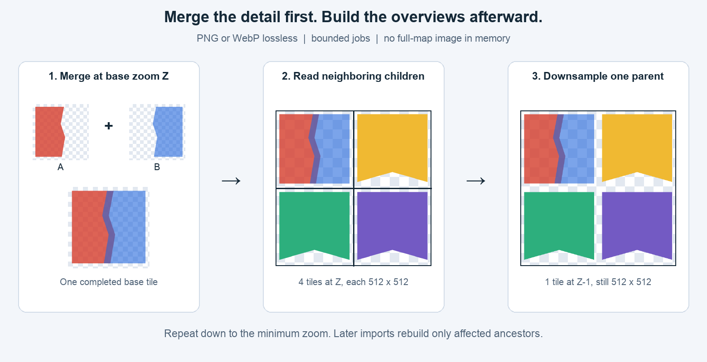
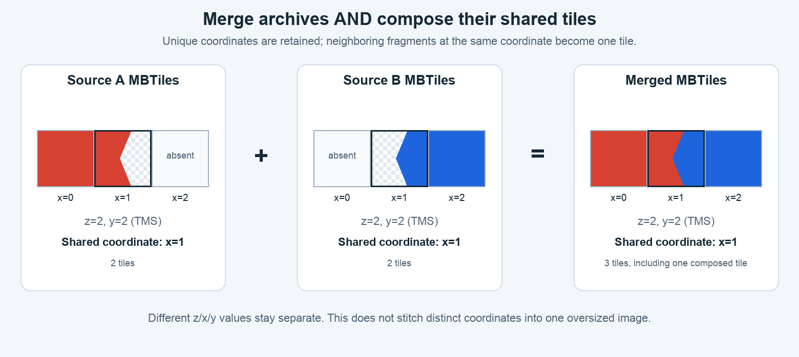
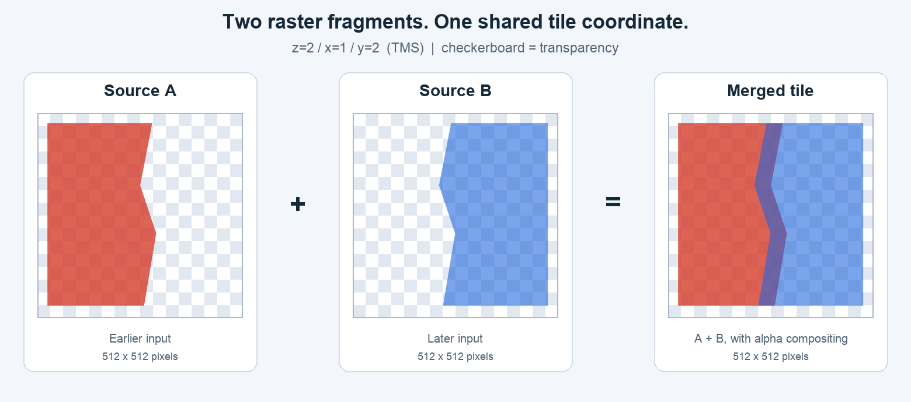

# mbmerge

**English** | [Čeština](README.cs.md)

Build an incremental, lossless raster MBTiles mosaic: **merge the highest source zoom first, then generate the lower zooms from the merged result**. PNG and WebP inputs, alpha compositing, bounded memory, parallel image workers, one SQLite writer, and crash-safe resume.

**Version 2 changes the default behavior.** New outputs use pyramid mode. Existing version 1.x outputs are refused without modification: rebuild into a new output from the original inputs. Use `--mode overlay` explicitly when you want to retain and composite every supplied zoom instead of generating overviews.

Supported: Linux/macOS (POSIX), Python 3.11+, SQLite 3.35+, Pillow 10.4+. Inputs must use the same Web Mercator/TMS grid and square tile size (512 px by default), with a flat indexed `tiles` table. Static PNG and WebP may be mixed. `mbmerge tile` creates such inputs from GDAL rasters (GeoTIFF, PDF, VRT, JPEG …) and additionally needs GDAL ≥ 3.11: its command-line tools and the same version of its Python bindings (`osgeo`) with numpy. Windows, JPEG tiles, vector tiles, animated images, 16-bit PNG and normalized MBTiles are outside the current scope.

## One mosaic, then its pyramid



1. Choose one common base zoom `Z` from the actual tile keys, ignoring source `metadata.maxzoom`.
2. Import **only `Z`** from each source, in order. Later sources are drawn over earlier sources at the same `z/x/y`.
3. After all proposed sources finish, build `Z-1`, then `Z-2`, down to `--min-zoom` (default 0). Each parent is derived from up to four current children with an alpha-aware BOX area average. Missing children are transparent.
4. On later imports, regenerate only affected ancestors. An old overview is never composited with a new overview.

Default inference requires all nonempty inputs to have the **same actual highest zoom**. A source without the selected level is rejected before any source pixels from the proposed list are imported. Empty inputs are allowed alongside nonempty inputs. If resolutions differ, choose an explicit `--base-zoom Z` present in every nonempty input; this intentionally ignores every other supplied zoom. No source is silently dropped or upscaled. An all-empty initial pyramid requires an explicit base zoom.

Sources below the base zoom may contain precomputed overviews; pyramid mode ignores those images. Low-zoom labels or other scale-specific styling will therefore not be preserved. Use overlay mode for maps with deliberately different artwork at different zooms.

At the base zoom, shared coordinates are composited; distinct coordinates remain distinct tiles:



The bundled demo contains actual 512 px fragments with transparency:



## Install and try it

For a released version, use `pipx install mbmerge`, or install in a virtual environment. To test this checkout and its version 2 behavior:

```bash
python3 -m venv .venv
source .venv/bin/activate
python -m pip install .
python -m unittest discover -s tests -v

mbmerge merge \
  --input demo/source_a.mbtiles --input demo/source_b.mbtiles \
  --output demo/merged-v2.mbtiles --output-format webp --workers 2
mbmerge status --output demo/merged-v2.mbtiles
mbmerge verify --output demo/merged-v2.mbtiles --decode
```

The demo base is zoom 2; the output adds zooms 1 and 0. Its merged zoom-2 tile matches `demo/expected_overlap.png`. `demo/png/` contains the equivalent PNG inputs. The input coordinates are synthetic. Generated outputs are not committed because their ledgers contain local absolute source paths. `python -m mbmerge` and `python merge_mbtiles.py` use the same CLI.

```bash
# Explicit common level, generating only zooms 5..16:
mbmerge merge --input-dir /data/inputs --output /data/mosaic.mbtiles \
  --base-zoom 16 --min-zoom 5 --output-format png

# Retain every supplied zoom, without generating any:
mbmerge merge --mode overlay --input-dir /data/inputs \
  --output /data/supplied-levels.mbtiles

# Append a source later; infer the stored mode, base, minimum and format:
mbmerge merge --input /data/new.mbtiles --output /data/mosaic.mbtiles
```

## Lossless PNG and WebP

New outputs default to **lossless WebP**. Select `--output-format png` for PNG. Every newly encoded tile is lossless; WebP uses `lossless=True, exact=True`, preserving RGB values even under fully transparent pixels during encoding. Compression effort changes size/speed, not the encoded pixels. `quality=100` alone would not guarantee lossless WebP.

Unique matching PNG tiles and validated lossless WebP tiles retain their original encoded bytes. Unique **lossy WebP is decoded and re-encoded losslessly**, even without overlap. Conversion cannot restore detail already lost by the source. Overlaps and generated overviews always use lossless encoding. Repeated encoding does not introduce lossy compression artifacts; 8-bit compositing and downsampling still involve numerical rounding, and lower zooms necessarily contain less spatial detail.

PNG supports static palettes/transparency, grayscale, grayscale+alpha, RGB and RGBA up to 8 bits per channel. RGB is opaque. A declared `metadata.format` must match imported tile contents; missing declarations are detected from signatures. Every stored tile has the selected output format.

Mode, base zoom, minimum zoom, tile size, output format, resampling rule and active encoder setting are fixed for a managed archive. Omit `--mode`, `--base-zoom`, `--min-zoom` and `--output-format` on resume to infer them. Repeat a nondefault active compression setting (`--webp-method` or `--png-compress-level`). Rebuild into a new output to change the contract.

## Existing outputs, order and changed inputs

An output created by version 2 is **extended, never reset**. Re-running the same command validates and skips completed sources. New sources are appended; an active source is completed first, even if omitted from the new command. Source priority follows repeated `--input` arguments, then `--input-list` entries, then lexicographically sorted `--input-dir` paths. New files always append after historical layers, regardless of filename order.

A UTF-8 list contains one path per line. Blank lines and lines beginning with `#` are ignored; relative paths resolve against the list directory. Interior spaces are preserved. Newlines and leading/trailing whitespace in filenames are unsupported. Repeated paths in one command are deduplicated; different hard links to one source are rejected. Separate physical files with identical bytes remain separate layers.

Unmanaged output files and version 1.x ledgers (schemas 1/2) are rejected **before changing their journal mode or tiles**. Prefer original inputs when rebuilding. To use another archive as a flattened source, pass it as the first `--input` and select a **new** output path. This preserves its already-flattened pixels; it cannot reconstruct original layers or restore source detail.

The output cannot also be an input, have hard links or match the input glob. Keep it outside the input directory. Inputs must remain offline, closed and available at their recorded absolute paths. The CLI does not remove an earlier source or relocate its path. A changed imported source is refused by default; restore its exact bytes, rebuild to a new output, or overlay the new version with `--reimport` (below).

Every invocation checks **all recorded sources**, including those omitted from the command. By default (`--verify-recorded sha256`) it re-hashes them, which detects edits with restored size/mtime at the cost of sequential I/O; **import a large initial collection in one invocation**. `--verify-recorded stat` compares the recorded stat fingerprint (device, inode, size, mtime, ctime) and hashes only files whose stat changed. A touched but byte-identical file stays accepted and its new stat is remembered; a restored mtime does not hide an edit because ctime still changes. Use it when a pipeline appends one source at a time to a large history.

## Overlaying a new version again: `--reimport`

`--reimport` applies to sources that are **listed in this run** and already completely imported:

| value | effect |
|---|---|
| `never` (default) | completed sources are skipped; a changed one is refused |
| `changed` | a source whose content differs from the recorded hash is overlaid again; unchanged ones are skipped |
| `always` | every listed source is overlaid again, changed or not |

A reimported source is composited **over the current output**, exactly like a new layer, and becomes the topmost layer at that moment; its affected ancestors are regenerated. The ledger switches to the new hash in the same transaction that resets the source's cursor, so a crash resumes it like any interrupted import and never applies a committed batch twice.

This is exact under two conditions, which hold for e.g. clipped, opaque map sheets:

1. **Alpha is 0 or 255.** Overlaying a source with partial alpha again makes those pixels more opaque (128 over 128 gives 192). `mbmerge tile --binary-alpha` produces such sources.
2. **The new version covers the old one.** Pixels that only the old version had are not removed. Removing a layer still requires a rebuild into a new output.

With both, re-running `--reimport always` any number of times leaves the output byte-identical.

## Empty tiles

A fully transparent source tile changes nothing, so `merge` does not store it (neither as a unique tile nor over an existing one) and reports the count as `empty_skipped`. `--keep-empty` stores unique transparent tiles as before. Only alpha decides: an opaque white or black tile is content. Turning nodata colors into transparency is the job of the input preparation, e.g. `mbmerge tile --collar`/`--nodata`.

## Creating inputs: `mbmerge tile`

```bash
mbmerge tile plan.pdf --output plan.mbtiles --zoom 17 --min-zoom 0 \
  --cutline municipalities.shp --cwhere "KOD = '530310'" --binary-alpha
mbmerge tile --input-dir /data/ortho --pattern '*.jpg' --s-srs EPSG:5514 --output ortho.mbtiles \
  --zoom 19 --min-zoom 0 --quality 85 --collar black --collar white --near 15
```

The result is a flat TMS MBTiles (lossless WebP by default, or `--format png`) that `merge` accepts as is; unique tiles are then copied without re-encoding. `--quality Q` writes lossy WebP instead, for imagery that is published as it is (orthophotos: 5× faster to encode and 8× smaller than lossless); `merge` would store such tiles re-encoded losslessly. Steps:

1. **Per input:** PDF rasterized at `--pdf-dpi` (300). An input without a coordinate system is refused unless `--s-srs` names one: a world file (`.jgw`, `.tfw`) carries the position only, and GDAL would otherwise silently read S-JTSK coordinates as Web Mercator metres. Palettes are expanded to RGBA. Declared nodata, masks and alpha are always honoured. `--collar COLOR` (repeatable: `black`, `white` or `R,G,B`) makes edge-connected collars transparent like `nearblack -setalpha`, with tolerance `--near` for lossy sources; black or white areas inside the image stay. `--nodata R,G,B` (repeatable) makes an exact color transparent **everywhere** in the input. Both happen before any resampling, so collars cannot blend into valid pixels.
2. Several inputs form one mosaic; later inputs are drawn over earlier ones.
3. **One warp** to EPSG:3857 at exactly the resolution of `--zoom`, aligned to the tile grid, as a VRT limited to the extent of the input — and with `--cutline`/`--cwhere` to its intersection with the polygon, so a country-wide boundary over one sheet does not walk the empty rest of the country. Without `--zoom` the level nearest to the source resolution is used. `--resampling auto` uses `average` when the source is finer than the target, else `bilinear`.
4. **Base tiles straight into the MBTiles**, nothing staged on disk: `--threads` worker processes each read contiguous rows of tiles from the warp, so every source is read forward (scans and JPEGs stored one row per strip are not decompressed again for every tile). They burn the cutline polygon into alpha in the target grid (pixel-centre rule), skip fully transparent tiles (`--keep-empty` keeps them), snap partial alpha to 0/255 with `--binary-alpha [T]` (threshold 128) and encode losslessly; the parent is the only SQLite writer. Each worker has a GDAL block cache of `--worker-cache-mib` (128): a baseline JPEG cannot seek back, so the cache must hold the source lines one row of tiles spans — about 95 MiB per sheet for 0.125 m orthophoto at z19; at 64 MiB the sheets are decoded again and tiling is three times slower. A worker then needs about 500 MB.
5. Levels down to `--min-zoom` (default: base only), with the same premultiplied 2×2 average as `merge` uses for its pyramid. The workers build the first four levels below the base from the pixels they have just encoded (work rectangles are aligned to blocks of 16 × 16 tiles, one pending row per level); lower levels come from the stored tiles above. With `--quality` the lowest worker level is also kept losslessly in a side file next to the output until the end, so **no level is ever averaged from decoded lossy tiles**. Levels below the base are for previews or for lossy imagery; `merge` in pyramid mode ignores them. Metadata record bounds, zooms and the settings used (`mbmerge:tile`).

**Resume.** The output is written to `<output>.tmp`, committed after every row of tiles and kept when the run fails or is killed. `--resume` continues it, finished work rectangles and overview levels included, when the inputs (path, size, mtime) and every setting are the same; otherwise it refuses. `--threads` may differ. The result is byte-identical to an uninterrupted run.

**Colour grade.** `mbmerge grade` measures one grade for a whole mosaic and writes it as JSON; `tile --grade FILE` applies it to every pixel before encoding, so all levels inherit it and nothing is encoded twice. It is one function for every pixel — levels per channel (black/white point from histogram percentiles of all inputs read at 1/8, `--clip`), gamma (`--gamma auto` puts the median luma at `--target-median`), saturation and vibrance (more boost for dull colours than for saturated ones) — so it cannot create a seam between inputs. `mbmerge grade --preview FILE --at LON,LAT … --out DIR` renders before/after crops for tuning, `compare --grade` grades the reference the same way. A stretched image carries more detail and noise: expect larger tiles at the same `--quality`. The grade is part of the resume contract.

**Balance.** A national orthophoto is delivered as a grid of map sheets cut from flights of different days. The flight blocks differ in haze and exposure, so they show as rectangles of another tone with straight seams on the sheet edges. A global grade cannot remove that, and matching the tone across the seams alone is not enough either: a flight in the harvest next to a spring one differs in its fields, and matching those would light up or darken the whole block. `mbmerge balance --landcover RASTER` therefore anchors the colour on land that looks the same on any summer day. By default these are forests and built-up areas, ESA WorldCover classes 10 and 50 (`--classes`); any land cover raster over the mosaic works, e.g. a VRT of the WorldCover 2021 tiles (CC BY 4.0). The tiles of the balanced mosaic contain no WorldCover pixels, the land cover only decides where the colour is measured; credit it in the documentation of the product: "Colour balancing uses ESA WorldCover 10 m 2021 v200 (© ESA WorldCover project 2021 / Contains modified Copernicus Sentinel data (2021) processed by ESA WorldCover consortium, CC BY 4.0)." Every sheet is read once at `--sample` units per pixel (1 by default, through its overviews). Per sheet and channel, the 10th to 90th percentiles of both classes give a line onto the national percentiles (the anchor): a hazy sheet has bright, flat forests and gets more contrast and less offset. 4-pixel strips along the sheet edges are compared at nodes every `--node` units (250) by robust orthogonal regression within `--window` (±500). Edges inside a flight block use all bins; edges between flights use only bins on invariant land, so changed fields do not count. Every sheet gets a grid of nodes with a log gain and an offset per channel, and all sheets are solved together as a membrane: seams close exactly, the nodes stay smooth inside a sheet and are pulled towards their sheet's anchor (`--anchor-weight`). The inputs must tile a regular grid of equal north-up sheets. `tile --balance FILE` evaluates the correction at the centre of every output pixel from its position, before `--grade`. The result depends only on the position, and the file enters the metadata and the resume contract. `grade --balance` measures and previews a grade on the balanced mosaic (linked levels by default), and `compare --balance` balances the reference the same way. Content that changed between flights (harvested fields next to green ones) stays: forests, towns and exposure are matched, not the season.

Two adjacent sources clipped by the same boundary into the same grid get complementary pixels, so the merged mosaic has no seam and no overlap at that boundary.

## Bounded memory and one writer

The parent owns all SQLite connections. Workers use `spawn`, receive only bounded blobs and return encoded images. Both phases share the same worker pool, job limits and single writer.

- Indexed keyset pagination selects base keys without `OFFSET`. Keys and blob lengths are checked before fetching image data.
- A small temporary key table probes output tiles by primary key; joins do not scan the full output for each batch.
- Pending parents live in a deduplicated `_merge_dirty` SQLite table. No complete raster or unbounded Python dirty set is loaded.
- Overview jobs read at most four children. The highest pending level is always processed first. Four-child lookup tables have at most `4 × batch_size` entries.
- Byte budgets include encoded inputs, existing data and worst-case output capacity. WebP reserves transcoding capacity even for unique coordinates, because its format declaration does not guarantee lossless RGB.
- At most `--max-inflight` submitted/completed-but-unconsumed jobs exist. Bounded `executemany` buffers apply backpressure to workers.
- Decoder dimensions, blob lengths and PNG CRC/structure are checked. SQLite mmap is disabled, cache sizes are limited and temporary data may spill to disk.

| Option | Default | Meaning |
|---|---:|---|
| `--mode` | `pyramid` for new outputs | `pyramid` or `overlay`; inferred on resume |
| `--base-zoom` | common actual maximum | only this source level is imported in pyramid mode |
| `--min-zoom` | 0 | lowest generated level |
| `--output-format` | `webp` | lossless `webp` or `png` |
| `--tile-size` | 512 | square dimensions, 1..4096 px |
| `--workers` | up to 4 | spawned image workers |
| `--max-inflight` | 2 × workers | bounded pending jobs |
| `--batch-size` | 128 | maximum source keys or parents per transaction |
| `--batch-mib` | 32 | encoded-data budget including result capacity |
| `--max-tile-mib` | 4 | maximum input, stored or output blob |
| `--sql-batch-size` / `--sql-batch-mib` | 16 / 4 | bounded SQL result buffers |
| `--cache-mib` / `--source-cache-mib` | 32 / 8 | SQLite caches |
| `--webp-method` | 4 | lossless compression effort 0..6 |
| `--png-compress-level` | 6 | compression effort 0..9 |
| `--busy-timeout` | 5 s | lock/checkpoint timeout |
| `--reimport` | `never` | `changed`/`always` overlays listed, already imported sources again |
| `--verify-recorded` | `sha256` | `stat`: hash recorded sources only when their stat changed |
| `--keep-empty` | off | store unique fully transparent tiles |
| `--log-interval` | 5 s | tile progress interval; source completions always logged |

Pyramid mode requires `batch_mib >= 5 × max_tile_mib` for four maximum-size children and one parent. Overlay mode requires a factor of three. For example:

```bash
mbmerge merge --input-list /data/inputs.txt --output /data/mosaic.mbtiles \
  --workers 2 --max-inflight 2 --batch-size 64 \
  --max-tile-mib 2 --batch-mib 12 --cache-mib 16 --source-cache-mib 4 \
  --json-log 2> /data/merge.jsonl
```

These are encoded-data budgets, **not hard RSS caps**. Add Python/Pillow processes, serialization, native encoder buffers and decoded images. Each overview worker uses a `2S × 2S` canvas and premultiplied/downsampled image buffers. The path list and small source descriptors also consume memory proportional to the number of files. Use an OS memory limit when an absolute cap is required. After an OOM kill, resume from the last committed transaction.

## Transactions, resume and publication

Base pixels, source cursor, dirty immediate parents and metadata commit together. Overview pixels, removal of their dirty keys, insertion of the next parents and progress commit together. A failed/uncommitted batch repeats safely; a committed translucent source batch is never applied twice. Source completion requires a final SHA-256 match. A source changing during import marks its ledger `tainted` and blocks continuation.

The global phase is `empty`, `importing`, `building` or `complete`. `status` includes it, pending parents and the persisted overview write count. `metadata` also exposes `mbmerge:phase` and `mbmerge:mode`. `verify` rejects an incomplete import/pyramid; `--decode` additionally checks all images and rejects lossy WebP in a managed output. These checks do not independently reconstruct the mosaic or re-hash inputs; `merge` checks hashes on resume.

Readers can see committed base updates alongside old/missing overviews **until the phase is complete**. Publish only a completed, closed archive. Append imports can extend an interrupted build; pending ancestors are then rebuilt from all current children.

WAL uses `synchronous=FULL` and explicit `wal_checkpoint(TRUNCATE)` after each commit. A blocking reader stops the merge rather than allowing WAL to grow through later batches. Close readers and resume. The cooperative `*.merge.lock` file stays on disk; never delete a live lock or modify `_merge_*`/tiles outside this tool. Use local SQLite-compatible storage; NFS/network shares are unsupported. Allow output, WAL/index overhead, dirty-key storage and free-space margin. No automatic VACUUM or complete raster working copy is created. Do not copy only the main file while a live uncheckpointed WAL exists.

Exit codes: 0 success, 1 operational error, 2 invalid arguments, 130 handled Ctrl-C/SIGTERM. Resume after interruption by repeating the command, or use `merge --output ...` when all input paths are already recorded.

## TMS and metadata

Rows use TMS (0 is south); image rows run top-to-bottom. Overview assembly places north children above south children. Explicit XYZ is rejected; missing `scheme` assumes TMS. Integer zooms 0..30 and coordinates in `[0, 2^z)` are supported. Incorrect CRS/grid labels cannot be inferred from pixels.

`minzoom`/`maxzoom` are indexed end-point lookups over actual committed output levels, including generated parents. `bounds` aggregate valid source declarations or base tile footprints; they do not expand to whole overview tile footprints. Declared bounds are trusted, may include an unfinished source's full extent, and are not cropped by alpha. Wrapped bounds conservatively expand to `[-180,180]`. `center` is the bounds midpoint at the current minimum zoom.

`format`, `scheme=tms`, `version=1.3`, name, description, type and deduplicated attributions are maintained atomically. Name/description/type may be changed on resume. Attribution is limited to 64 KiB per source value and 1 MiB total. Fully transparent source tiles are not stored (see Empty tiles); empty sources contribute no extent/attribution.

## Tests and measurements

```bash
python -m unittest discover -s tests -v
mbmerge verify --output /data/mosaic.mbtiles --full-sqlite-check --decode

# Two larger sources; sampled parent+descendant RSS:
python tests/benchmark_memory.py --tiles 64 512 --work-dir /data/tmp

# Many separate files, each supplying a shared z=1 overview and a z=14 base tile:
python tests/benchmark_pyramid.py --sources 128 7000 --tile-size 512 \
  --output-format webp --work-dir /data/tmp > benchmark-webp.local.json
python tests/benchmark_pyramid.py --sources 128 7000 --tile-size 512 \
  --output-format png --work-dir /data/tmp > benchmark-png.local.json
```

Tests cover merge-before-downsampling, asymmetric TMS quadrants, transparency, lossy-input transcoding, common-level validation, selective ancestor rebuilding, bounded queues/bytes, unchanged-source replay, source changes, SQL rollback, checkpoint blocking and actual SIGKILL around import **and overview** commits for PNG/WebP. See [TEST_REPORT.md](TEST_REPORT.md) and [BENCHMARK.json](BENCHMARK.json). Synthetic 7000-file tests are not evidence of throughput or correctness for a real 1 TB collection; validate a representative pilot first.

## Development, releases and license

[ARCHITECTURE.md](ARCHITECTURE.md) explains invariants and recovery. [RELEASING.md](RELEASING.md) covers GitHub Actions/PyPI. Tests/builds do not publish packages; publishing needs a stable GitHub Release, matching version tag, public repository, configured Trusted Publisher and the repository-level enable variable. Version 2 uses schema 3 and requires a new output for version 1.x archives.

Commit sources, tests, tools, documentation/images and the four named synthetic demo MBTiles. [.gitignore](.gitignore) excludes real datasets, outputs, logs, environments, credentials and package builds. Create extra demos with `examples/create_demo.py` and illustrations with `examples/create_readme_images.py`.

[MIT License](LICENSE.md), copyright (c) 2026 mbmerge contributors. [Czech translation](LICENSE.cs.md); the English license is authoritative.
